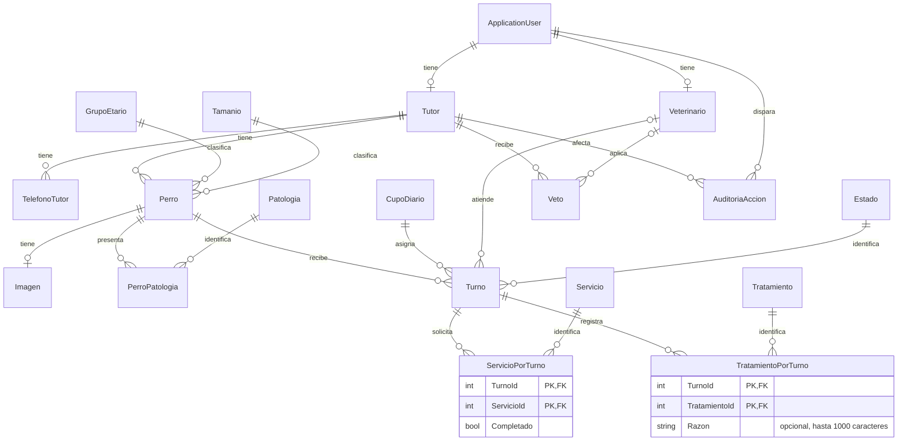

# DER de VetWeb

Relaciones del dominio vigentes. Las tablas de roles, claims y tokens de Identity conservan el esquema estándar. Una cuenta puede tener perfiles de Tutor y Veterinario; la autorización usa únicamente el rol activo.

`AgregarTratamientoPorTurno` reemplaza `Turnos.TratamientoId` por la tabla asociativa de clave compuesta. Cada tratamiento puede registrarse una sola vez por turno, con un motivo independiente. Las FK restringen el borrado de registros referenciados. La migración copia el tratamiento anterior sin inventar motivos. La reversión conserva el dato cuando aún es representable por el modelo anterior y falla explícitamente si existen motivos o varios tratamientos por turno.

El tratamiento previsto de un turno activo usa la misma relación y se revisa al registrar la atención. El cierre confirma el conjunto definitivo; los turnos finalizados y sus asociaciones son de consulta. Las bajas lógicas no eliminan el historial. Las fechas reales de solicitud y finalización permanecen en `AuditoriaAcciones`; no se agregan fechas ficticias a turnos anteriores.
